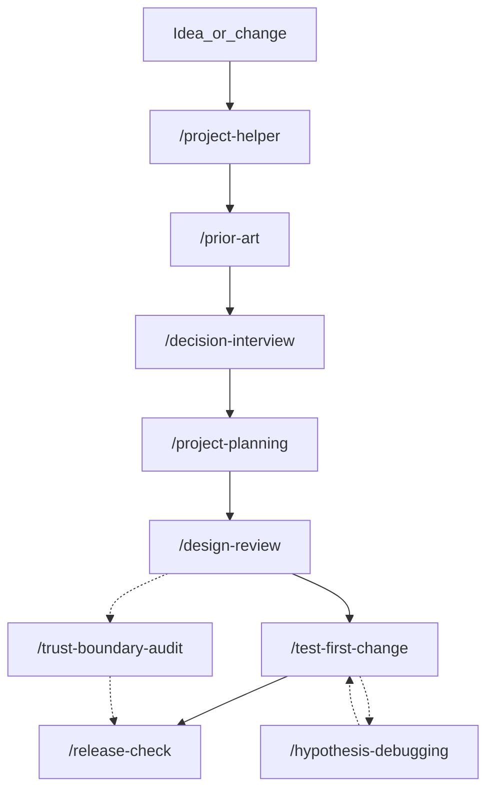

# Skill decision guide

Generated from `.cursor/skills/*/SKILL.md` skills-meta blocks. Do not edit by hand;
run `python scripts/generate_skills_guide.py` after changing skill metadata.

## Lifecycle

Use `/design-review` only for a new system or material design change.
Use `/trust-boundary-audit` only for sensitive boundaries or an audit request.
Use `/hypothesis-debugging` from any failure loop.

## Decision table

| Skill | Use when | Do NOT use when | Needs first | Produces | Done when | Typical next step | Weight |
|---|---|---|---|---|---|---|---|
| `/project-helper` | Starting a new project or improving the open project from one entry point | You already know which single specialized workflow to run and do not need routing | Open the target folder in Cursor | Mode choice, bounded plan or assessment, selected procedure path | Approved plan ready or review-only findings delivered | project-planning or the selected specialized workflow | standard |
| `/project-planning` | Defining requirements, architecture choices, or an implementation plan | The change is a typo, docs-only edit, or already has an approved plan for the same scope | PRD wording rules understood; repository context available | Requirements table, steps, risks, verification, approval request | Plan approved or blockers recorded | decision-interview if blockers remain; else design-review or test-first-change | standard |
| `/decision-interview` | Unresolved decisions block planning or implementation | Requirements are already settled or the user asked not to interview | Facts gathered from the repository | Recorded decisions, exclusions, remaining blockers | Zero implementation blockers remain for the agreed scope | project-planning | standard |
| `/design-review` | New system or material design change needs fresh-context review before coding | Change is bounded under an already approved design | Draft design with requirements and assumptions in-document | Review findings, dispositions, human approval or unverified status | Human approval recorded or isolation reported unverified | test-first-change | strict |
| `/test-first-change` | Behavior changes that can be verified with executable checks | Prose/metadata-only changes with no executable behavior | Approved requirements or plan for the slice | Red/green evidence and linked requirement evidence | Slice green and affected regressions pass | release-check or next slice | standard |
| `/hypothesis-debugging` | A reproducible failure, failing test, or unexpected runtime behavior | No reproduction exists yet and cannot be obtained | Expected vs actual behavior and smallest reproduction | Root cause, fix, verification commands/results | Reproduction passes and temporary diagnostics removed | test-first-change regression or release-check | standard |
| `/trust-boundary-audit` | Scoped security audit or changes to sensitive trust boundaries | No security-boundary effect and no audit requested | Agreed paths, revision, exclusions, permitted checks | Coverage ledger, findings with dispositions, report gaps | Every candidate has a disposition and gaps are listed | release-check | strict |
| `/release-check` | Before proposing publication, deployment, or claiming readiness | No release or readiness claim is being made | Diff/revision, PRD, quality-gate evidence | Evidence map, blockers, skipped gates, rollback readiness | Blockers listed or readiness claim evidenced | Fix blockers or authorized publish/deploy | standard |
| `/prior-art` | Starting a project or a non-tiny improvement that may reuse existing work | User skipped research, or the goal is a tiny typo/docs/CI/single-file fix | One-sentence goal | Capped fit-ranked candidate memo | Memo delivered or search unavailability disclosed | project-planning | light |

## Notes

- Weights are guidance for ceremony: `light` for tiny edits, `standard` for normal features,
  `strict` for high-risk or sensitive work. `/project-helper` may ask which weight to use later.
- Fresh-context isolation for design and security verification is a host capability; report unverified when unavailable.
